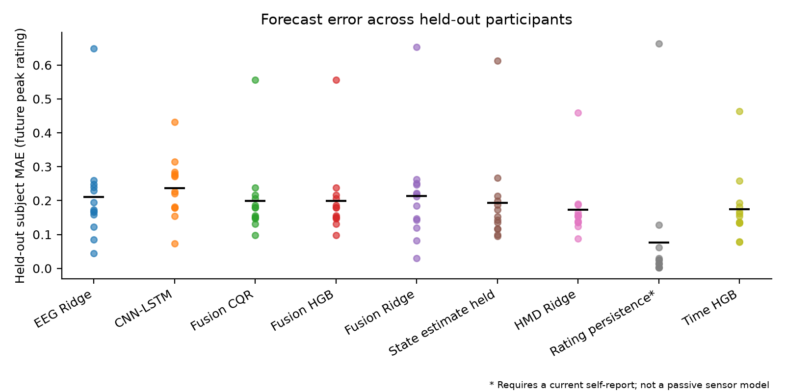
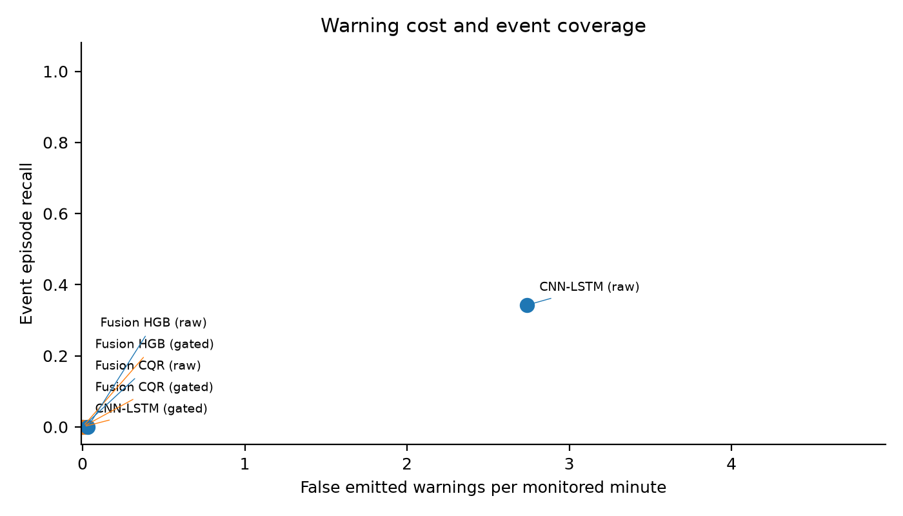

# When Does a Cybersickness Forecast Become an Actionable Warning? An Availability-Aware Evaluation

**Working English manuscript, 2026-10-15. Not a submission-ready or accepted paper.**

This draft reports completed public-data experiments and a tested Unity interface. It is an empirical feasibility study with negative primary results. No human mitigation experiment has been conducted. Secondary horizon and exploratory event-classification results are reported separately and cannot replace the primary result.

## Abstract

Cybersickness forecasting is useful for adaptation only when inputs precede the decision and warnings provide enough lead time at an acceptable false-alarm burden. We evaluate a causal pipeline on publicly released electroencephalography and headset-motion recordings. An availability and label-coverage audit retains 1,397 decision windows from 43 recordings and 13 participants, including 84 deterioration-positive windows. Nine comparators are evaluated with participant-disjoint fitting, calibration and testing across three calibration-split seeds. Future six-second peak-rating MAE is 0.1997 for fused gradient boosting, compared with 0.1929 for a sensor-estimated current state held constant and 0.1728 for headset-only Ridge regression. The quantile gate attains 80.64% empirical interval coverage but emits no warnings. A rebuilt CNN-LSTM attains 34.25% episode recall before interval gating at 2.74 false warnings per monitored minute. Even a label-informed diagnostic loses substantial lead time when two consecutive windows are required. Nine Unity editor checks verify replay and controller behavior, without establishing physiological benefit. Exploratory event classification also gives low recall under empirical false-warning constraints. These findings do not validate the proposed mitigation policy; they motivate evaluating action time and warning burden alongside forecast error before a live intervention study.

## 1. Introduction

An estimate of present discomfort and a warning of impending deterioration support different control decisions. An adaptation system needs to know whether a useful change is likely soon enough to act, how often warnings are incorrect, and whether the adjustment itself imposes unnecessary costs. Prior work has already investigated multimodal onset forecasting [2], EEG-based continuous estimation [1], and prediction coupled to adaptive reduction [4]. Therefore, forecasting alone is not a novel claim of this work.

We focus on the operational validity of a warning stream under participant generalization. Receiver timestamps, packet batching, window boundaries, subjective-label timing, and uncertainty calibration can affect whether an offline result represents a deployable warning. We evaluate a deliberately lightweight forecasting pipeline before making claims about an additional sensor's value or deploying a controller.

The implemented contributions are (i) an auditable availability-time formulation and reproducible protocol for future increases in self-report; (ii) an empirical analysis revealing the limitations of error, interval coverage and repeated-confirmation rules as indicators of actionable warnings; and (iii) a replay integration with controller checks. These artifacts support reproducible comparison and a concrete assessment of whether warning behavior merits live evaluation. The experiments do not establish an improved forecasting algorithm, a new conformal-prediction theorem, or symptom reduction.

## 2. Related Work

Demirel et al. [1] proposed continuous EEG and head-motion estimation and released the recordings used here. Islam et al. [2] studied forecasting from physiological, eye-tracking, and head-tracking streams. Choi et al. [3] explored long-term multimodal forecasting. Ridwan et al. [4] jointly modeled severity and properties of a blur countermeasure. Recent ISMAR 2026 work additionally studies personalized 30/60-second forecasts [6]. PRECYSE [7] investigates multimodal spatial and temporal transformer representations and releases normalized sensor and spectrogram samples. These systems differ in sensors, label schedules, forecasting horizon, personalization and test splits; headline errors should not be compared across datasets as if they were the same task.

Conformalized quantile regression [5] combines conditional quantile estimates with residual calibration. We use participant-disjoint calibration to evaluate empirical interval behavior. Temporally correlated windows and participant distribution shift mean that an ordinary exchangeability-based coverage theorem is not automatically a guarantee for a new VR user.

## 3. Task and Data

The source study reports 16 participants [1]. We downloaded 207 released EEG, headset-transform and SubjectiveCs streams, covering 69 recording identifiers, and retained source identifiers and file hashes. Twenty recording identifiers are excluded by the audit; six additional recordings pass stream-level checks but contain no complete forecast windows. The resulting task contains 43 recordings, 13 participants and 1,397 windows, with 84 deterioration-positive windows (6.01%). Nine participants have at least one positive window. These windows form 45 label-defined event episodes over 69.85 monitored minutes; they are not 45 independent clinical onsets. One participant contributes only one valid window and another contributes 13, making equal-participant weighting sensitive to sparse records. Per-participant counts and exclusions accompany the results.

Exclusion checks include header-only exports, absent streams, late clock resets and insufficient rating coverage. Two recordings with ratings exceeding the documented 0–1 range are excluded rather than clipped into the valid range. A short startup prefix is removed only when all clock resets meet the fixed startup criteria; later resets exclude the recording. We do not assume that the number of retained participants should equal the publication's recruitment count.

Let t be the end of an input window and r(t) the last self-rating received by t. The primary target is the maximum piecewise-constant rating y(t) in (t,t+6s], with deterioration d(t)=y(t)-r(t). A deterioration event is d(t)>=0.1 on the published 0–1 scale. This threshold operationalizes a label change and is not a clinical criterion. Three- and nine-second horizons are secondary sensitivity analyses.

The sensor model receives neither current nor future ratings. It separately predicts the future peak and the deterioration increment. A comparator that holds the actual current rating constant is explicitly labeled **oracle rating persistence**, since using it in a passive application requires a live user report. A sensor model trained to estimate present rating and then held constant is a separate deployable state-persistence comparator.

## 4. Causal Processing and Forecasts

EEG rows retain their published receipt times, including repeated timestamps. HardwareSeconds is not assumed usable when it is constant. Filtering runs once in the forward direction at the configured native rate, with notch and 1–40Hz band-pass stages. No full-record normalization, future signal interpolation or forward-window spectrum averaging is used.

At the end of each non-overlapping three-second window, multitaper spectra yield five frequency-band power descriptors. The primary analysis uses 19 scalp channels, excluding auxiliary and reference channels. Temporal-relative descriptors subtract an initial three-window unlabeled session reference that must be available before any decision. Kinematic features summarize linear speed, angular speed and acceleration within the received headset samples. The current and preceding two windows form a nine-second feature history; history is not joined across missing windows.

Data integrity is quantified by received-sample completeness and coverage. It is not equivalent to a validated EEG artifact detector. Windows with inadequate coverage or large gaps are excluded and counted. The scoring stream is held causally and targets are not formed across long reporting gaps.

The reference models are Ridge regression and histogram gradient boosting. A quantile model estimates the 10th, 50th and 90th percentiles of d(t). Calibration residuals from participants excluded from model fitting expand the interval to the preselected nominal level of 80%. The fused HGB and CQR variants share the same future-peak regressor; their MAEs are therefore identical by construction. Their deterioration heads and warning intervals differ. The calibrated lower bound is used for a conservative warning, subject to data completeness. Two successive independent forecast updates must satisfy the criterion; warnings have a 12-second refractory period. These choices are fixed in the machine-readable protocol.

We also rebuild the public dual spectral/kinematic CNN-LSTM architecture family [1]. It receives a causal 24-channel spectral tensor and a 16-channel kinematic tensor, with separate convolutional and two-layer LSTM encoders and two forecast outputs. Unlike the primary 19-scalp-channel band-feature models, this architecture comparison retains the source family's full spectral input. A fitting-only participant selects the epoch count, up to 60 epochs with patience ten; the model is then refit on all fitting participants. Normalization excludes calibration and test participants. An absolute-residual interval is calibrated on the separate calibration group. Preprocessing, supervision and evaluation are retargeted to the present task, so this is an architecture comparison, not an exact replication of published accuracy.

## 5. Evaluation

An outer leave-one-participant-out split assesses user generalization. A separate subset of the remaining participants calibrates intervals, and GroupKFold over fitting participants selects parameters. All preprocessing statistics, imputation, scaling, tuning and calibration exclude the held-out participant. Seeds 7, 19 and 42 characterize sensitivity to calibration-subject selection.

Comparators include oracle rating persistence, time alone, estimated-current-state persistence, EEG alone, headset motion alone, feature fusion, and the rebuilt CNN-LSTM. Predictions and split manifests cover all nine models, three seeds and 13 held-out participants (351 model/seed/participant combinations). Published numbers on transformed labels are not used as directly comparable baselines. Implementation of additional state-of-the-art forecasting methods and independent-data validation remain necessary before a strong comparative claim.

We report future-peak MAE and RMSE, deterioration average precision, episode recall, false emitted warnings per monitored minute, and warning lead time. Consecutive positive target windows are merged into event episodes. Lead time on matched warnings must be interpreted with recall: a policy producing no warnings has not solved mitigation. Prediction intervals are evaluated using realized coverage and width. Seeds are averaged within participants before participant macro averages and paired participant-block bootstrap intervals are computed.

## 6. Retrospective Results

### 6.1 Future-peak estimation

Table 1 reports participant macro averages after averaging seeds within each participant. Values are on the original 0–1 self-report scale. Oracle rating persistence observes the actual current rating and is a rating-available comparator; its advantage cannot be interpreted as a fair sensor-only comparison.

| Model | Future-peak MAE | Deterioration AP | Interval coverage |
|---|---:|---:|---:|
| Oracle rating persistence | 0.0758 | 0.1257 | — |
| Time HGB | 0.1752 | 0.1925 | 0.7297 |
| Sensor-estimated state held | 0.1929 | 0.1257 | — |
| HMD Ridge | 0.1728 | 0.1553 | 0.6785 |
| EEG Ridge | 0.2105 | 0.1865 | 0.7892 |
| Fusion Ridge | 0.2133 | 0.1914 | 0.7808 |
| Fusion HGB | 0.1997 | 0.1603 | 0.7044 |
| Fusion CQR | 0.1997 | 0.1257 | 0.8064 |
| Fusion CNN-LSTM | 0.2362 | 0.2012 | 0.7511 |

Fusion HGB does not improve the observed mean MAE over sensor-estimated state persistence. Neither feature fusion nor the EEG-only model provides evidence of an improvement over the HMD-only comparator in this evaluation. The time-only model performs similarly to HMD Ridge, which cautions against attributing all sensor-model performance to informative physiology. The paired participant-block bootstrap difference for Fusion HGB minus sensor-estimated state persistence is +0.0067 MAE (descriptive 95% interval -0.0103 to +0.0239), which does not establish an advantage. These are descriptive findings within this dataset, not proof that EEG cannot help under another task or acquisition setup. AP includes the eight participants with both classes; episode recall includes the nine participants with positive episodes.

Window weighting gives a different emphasis: mean window-weighted MAE across seeds is approximately 0.1688 for Fusion HGB/CQR, 0.1529 for estimated-state persistence, 0.1463 for HMD Ridge and 0.0191 for oracle rating persistence. The large difference between the oracle's macro and window-weighted errors illustrates how sparse participants affect aggregate results. The archived report includes all participant values and participant-block bootstrap comparisons; exploratory pairwise intervals are not multiplicity-adjusted.

### 6.2 Coverage is insufficient for usable warnings

The CQR interval covers 80.64% of held-out deterioration targets, with macro mean width 0.0795. However, its lower-bound warning policy emits no warnings: episode recall and false warnings are both zero. Thus near-nominal marginal coverage does not establish informative lower bounds for rare deterioration events. A system that remains inactive cannot provide evidence of effective adaptive intervention.

Before interval gating, the CNN-LSTM reaches episode recall 0.3425 at 2.7388 false warnings per monitored minute; mean of participant median lead times on matched warnings is 3.11 seconds. Interval gating suppresses all of its warnings. Raw Fusion Ridge reaches recall 0.1687 at 0.9318 false warnings/minute, and its gated version reaches recall 0.0370 at 0.0903 false warnings/minute. These tradeoffs show why lead time on successful alerts must be reported with missed episodes and warning burden. Under the ten-second warning-hold convention used by replay, the raw CNN-LSTM warning state would be active for 48.19% of monitored decision-cell time, compared with 17.06% for raw Fusion Ridge and 1.53% for gated Fusion Ridge. This derived occupancy excludes unmonitored gaps and precedes controller smoothing; it is not observed slowing, task time lost, or physiological benefit. There is no supported deployment recommendation for the v1 policy.

### 6.3 A label-informed diagnostic of confirmation delay

To separate policy delay from model failure, an explicitly non-deployable diagnostic substitutes the true future deterioration for the predicted score while retaining window timing and the 12-second refractory period. With one required confirmation, macro episode recall is 0.8975 and mean of participant median lead times is 3.80 seconds. With two confirmations, recall falls to 0.4323 and lead time to 1.41 seconds. Both have zero false warnings. This diagnostic uses future labels and is never counted as predictive performance or a strict optimal-policy bound. It shows that the original two-window rule consumes much of the six-second horizon even under unusually favorable information.

### 6.4 Secondary horizon analysis

Three- and nine-second analyses retain the primary processing and participant separation, while fitting only oracle persistence, fused HGB and fused CQR. All three seeds are complete. The three-second task retains 1,448 windows from 13 participants, with 52 positive windows (3.59%); the nine-second task retains 1,353 windows from 12 participants, with 110 positive windows (8.13%). Horizon-dependent label availability changes both the decision cells and, at nine seconds, the participant set. Calibration-group composition can therefore also change. Table 2 is a sensitivity analysis on the available cohorts, not a controlled ablation isolating horizon length.

| Horizon | Participants / windows | CQR MAE | Interval coverage | Gated recall |
|---|---:|---:|---:|---:|
| 3 s | 13 / 1,448 | 0.1850 | 0.8579 | 0.0000 |
| 6 s | 13 / 1,397 | 0.1997 | 0.8064 | 0.0000 |
| 9 s | 12 / 1,353 | 0.1702 | 0.8651 | 0.0000 |

CQR emits no warnings at any horizon. At nine seconds, raw Fusion HGB reaches recall 0.0243 at 0.0914 false warnings/minute, which still does not establish a useful trigger. The lower nine-second peak MAE cannot be interpreted as an improvement caused by extending the horizon, given the cohort and label changes. In the future-label diagnostic, the three-second two-confirmation rule recalls no event episodes; at nine seconds it recalls 0.7865 with 4.30 seconds mean participant-median lead. These diagnostic values use future labels and remain outside model-performance claims.

### 6.5 Exploratory direct-event classification

After observing the v1 failure, we specified a separate class-weighted HGB classifier on the same causal fusion features. Its settings are fixed at 100 iterations, seven leaves, learning rate 0.05 and L2 regularization 10. No additional hyperparameter search is performed. On calibration participants only, a 41-quantile score-threshold grid plus a no-action threshold maximizes episode recall subject to empirical mean false-warning budgets of 0.1, 0.5 or 1.0/minute. The classifier uses one confirmation and the same 12-second cooldown. Scores are ranking outputs of a weighted classifier, not calibrated probabilities. Table 3 averages all three seeds and 13 held-out participants.

| Policy | Episode recall | False/min | Lead (s) | Active (%) |
|---|---:|---:|---:|---:|
| Budget 0.1/min | 0.0000 | 0.0000 | — | 0.00 |
| Budget 0.5/min | 0.0123 | 0.0765 | 4.28 | 1.50 |
| Budget 1.0/min | 0.0667 | 0.4668 | 3.69 | 8.16 |
| Fixed score 0.5 | 0.0991 | 0.4715 | 2.76 | 9.28 |

All policies share the same ranking AP of 0.1906; only their thresholds differ. Active fraction uses the hypothetical ten-second replay hold, restricted to monitored cells. The strictest budget yields complete abstention. More permissive thresholds produce few detected episodes, and long lead on the few hits does not compensate for low recall. Calibration constraints hold empirically, but two of 39 held-out participant/seed folds exceed the 0.5/minute budget (maximum 1.71/minute); six exceed the 1.0/minute budget (maximum 3.53/minute). The calibration mean is not an individual-user guarantee.

This extension changes the learning target, class weighting, confirmation rule and threshold objective together, so it is not an ablation identifying which change caused a difference. It was defined after inspecting v1 outcomes, uses the same public dataset, and requires independent validation. It does not rescue the primary mitigation-feasibility claim.

## 7. Replay and Conditional Pilot

An exported stream is restricted to one held-out participant, recording, model and seed. It uses the existing Unity schema `timestamp_s,risk,quality,source`. A risk value of 0.7 denotes an active operational warning and zero denotes inactivity; the field is not a calibrated probability or medical severity score. A 0.1-second heartbeat maintains compatibility with the existing two-second timeout while gaps in forecasts remain gaps. A replay verifies the interface, not a physiological response to intervention.

The editor validation successfully checks nine properties: message-cadence-independent smoothing, rejection of non-finite quality, low-quality fallback, stale-message timeout, emergency-stop/resume behavior, rejection of invalid replay rows, continuous-rating validity and clearing, rating-scale provenance, and condition-marker state. The logger also records the last rating-update time and its age; held log samples are not treated as independent new symptom reports. These checks execute in Unity 2022.3.17f1; no headset measurements or participant outcomes are inferred from them.

The optional pilot targets eight participants in three counterbalanced within-participant conditions: ordinary locomotion, fixed comfort speed, and prediction-triggered slowing. It requires an approved protocol, a verified live EEG stream and a frozen model that first passes a warning-feasibility review. The present v1 model does not pass that review. The proposed pilot's principal outcomes are feasibility, data availability and execution latency; symptom and task differences would be exploratory. No human mitigation-result section is reported here.

## 8. Limitations and Discussion

The dataset is small and contains heterogeneous recording conditions. Most retained windows are event-negative, and one participant has only a single decision window. Equal-participant averages and participant-block bootstrap intervals are therefore unstable summaries rather than definitive population estimates. Strict availability and gap checks change the task and cohort relative to the source paper; the present negative result is not a refutation of that paper's distinct continuous-estimation task. The labels are subjective reports, receipt clocks can batch samples, and device latency may be unknown. Lead time is relative to a received self-report crossing, not physiological onset; reporting delay may consume part of any apparent warning margin. Completeness checks do not establish that scalp features reflect neural rather than movement or recording artifacts. Cross-participant testing within one released dataset does not establish cross-device or cross-environment transfer. Interval coverage must be measured under the observed shift rather than presumed from a theorem requiring exchangeability. Forecast horizon must not be equated with actionable intervention lead time after window consistency checks, smoothing and controller latency.

Retrospective predictions and replay cannot reveal whether an intervention would change a participant's symptoms. A pilot of five to ten people provides preliminary feasibility and effect estimates with substantial uncertainty; it cannot justify broad efficacy claims.

## 9. Conclusion

Under an availability-aware six-second task, the evaluated EEG/head-motion forecasters do not establish a useful mitigation trigger. Fusion fails to improve mean future-peak error over appropriate passive comparators; interval gating suppresses the strongest raw event detector, and repeated confirmation consumes actionable lead time. A functioning Unity interface does not remedy these prediction limitations. The next research step is to validate event-focused, user-adaptive warning policies on independent recordings with an explicit action-time and false-warning objective before conducting an approved live feasibility study. Evidence of reduced discomfort remains to be collected.

## References

1. Demirel, B. U., Dogan, A. H., Rossie, J., Möbus, M., and Holz, C. 2025. Beyond Subjectivity: Continuous Cybersickness Detection Using EEG-based Multitaper Spectrum Estimation. IEEE TVCG 31(5), 2525–2534. https://doi.org/10.1109/TVCG.2025.3549132
2. Islam, R., Desai, K., and Quarles, J. 2022. Towards Forecasting the Onset of Cybersickness by Fusing Physiological, Head-tracking and Eye-tracking with Multimodal Deep Fusion Network. ISMAR, 121–130. https://doi.org/10.1109/ISMAR55827.2022.00026
3. Choi, Y., Jeong, D., Kim, B., and Han, K. 2024. Early Prediction of Cybersickness in Virtual Reality Using a Large Language Model for Multimodal Time Series Data. UbiComp Companion. https://doi.org/10.1145/3675094.3677578
4. Ridwan, A. E. M., Saha, P., Quarles, J., and Islam, R. 2026. Two Phase Multi-Task Learning for Cybersickness Prediction and Adaptive Reduction. IEEE TVCG 32(5), 4543–4553. https://doi.org/10.1109/TVCG.2026.3680682
5. Romano, Y., Patterson, E., and Candès, E. 2019. Conformalized Quantile Regression. NeurIPS 32. https://papers.neurips.cc/paper_files/paper/2019/hash/5103c3584b063c431bd1268e9b5e76fb-Abstract.html
6. Ahmed, N., Wu, P., Huang, K., Lan, T., Li, B., Tan, G., Imani, M., and Islam, R. 2026. One Size Does Not Fit All: Personalized Cybersickness Forecasting with Asymmetric Few-Shot Meta-Learning. Official ISMAR 2026 program, paper 1180. Proceedings DOI and pagination are not asserted. https://www.ieeeismar.net/2026/papers/
7. Jeong, D. and Han, K. 2024. PRECYSE: Predicting Cybersickness using Transformer for Multimodal Time-Series Sensor Data. Proceedings of the ACM on Interactive, Mobile, Wearable and Ubiquitous Technologies 8(2), Article 42, 24 pages. https://doi.org/10.1145/3659594
