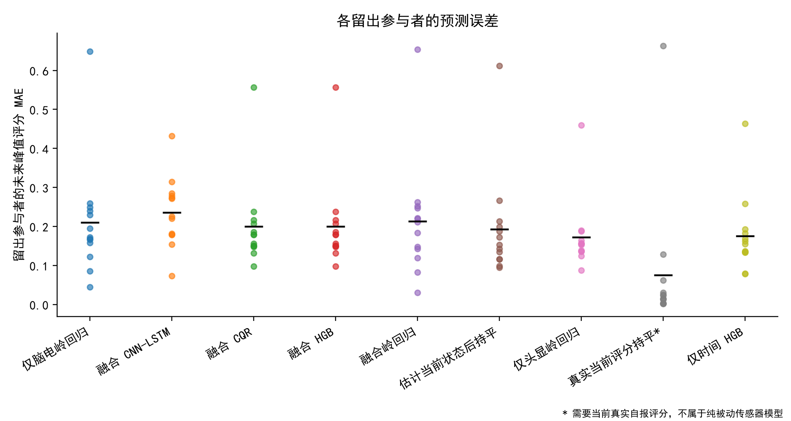
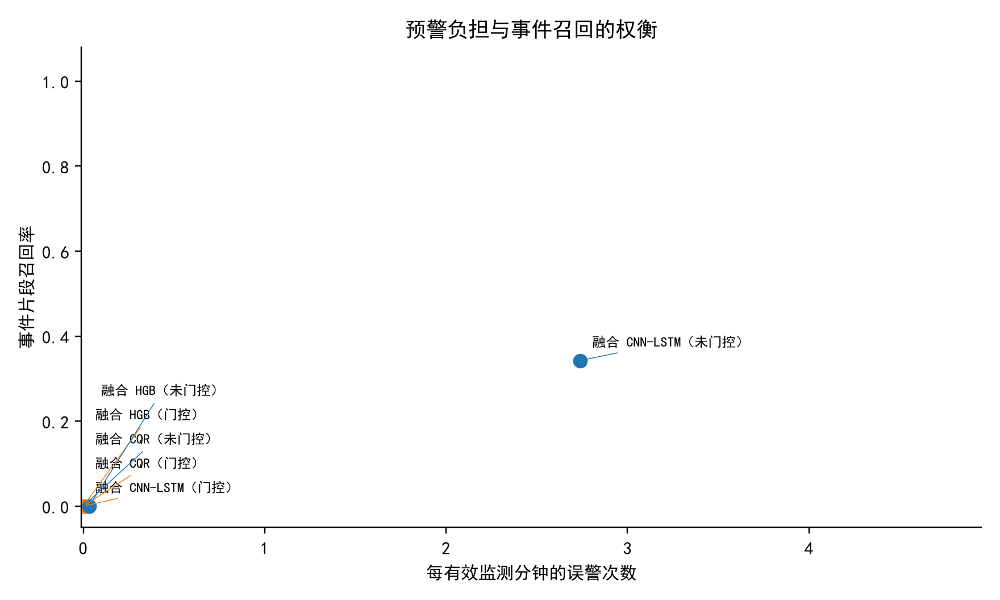

# 晕动症预测何时能够转化为可执行预警？一项考虑数据可获得时间的评估

**中文研究草稿，2026-10-15。尚非可直接投稿或已获录用的论文。**

本文件依据英文原稿 `manuscript.md` 复制翻译，沿用原稿的实验数据、分析范围和结论，参考文献保留原始书目信息。本文报告已经完成的公开数据实验及经过检查的 Unity 接口，是一项主实验结果为负的实证可行性研究。尚未开展验证晕动症减缓效果的受试者实验。预测时域敏感性分析与探索性事件分类结果分别报告，不能替代主实验结果。

## 摘要

只有当模型输入在决策之前已经可获得，且预警能够在可接受的误警负担下提供足够的动作提前量时，晕动症预测才对自适应干预有用。本文利用公开发布的脑电与头显运动记录，评估一套仅使用决策时刻及之前数据的因果处理流程。经数据可获得性和标签覆盖审计，最终保留 13 名参与者、43 段记录中的 1,397 个决策窗口，其中 84 个窗口的标签为症状恶化。实验采用参与者互斥的拟合、校准与测试划分，以三个校准划分随机种子评估九种对照或方法。对于未来六秒评分峰值，融合梯度提升模型的平均绝对误差（MAE）为 0.1997，传感器估计当前状态后持平对照为 0.1929，仅头显岭回归为 0.1728。分位数门控的经验区间覆盖率为 80.64%，但未发出任何预警。重建的 CNN-LSTM 在区间门控前达到 34.25% 的事件召回率，同时每有效监测分钟产生 2.74 次误警。即使使用未来真实标签进行策略诊断，要求连续两次窗口确认也会明显损失提前量。九项 Unity 编辑器检查验证了回放与控制器行为，但不构成生理获益的证据。在经验误警约束下，探索性事件分类的召回率同样较低。这些结果尚不能验证所提出的减缓策略；它们说明，在开展实时干预研究之前，应将可执行动作时间和预警负担与预测误差一起评价。

## 1. 引言

当前不适程度的估计与即将恶化的预警，支持的是不同的控制决策。自适应系统需要判断：状态变化是否可能在足够早的时间发生、预警有多大比例是错误的，以及调整本身是否带来不必要的代价。已有研究已经探索多模态发作预测 [2]、基于脑电的连续估计 [1]，以及与自适应减轻方法相结合的预测 [4]。因此，提前预测本身不是本文的创新主张。

本文关注模型面向未见参与者时，预警流在实际运行条件下是否有效。接收时间戳、数据包批量到达、窗口边界、主观标签的时间安排以及不确定性校准，都会影响离线结果是否能够代表可部署的预警。本文先评估一套刻意保持轻量的预测流程，再讨论额外传感器的价值及控制器部署。

已经实现的工作包括：（1）面向未来自报评分上升，提出可审计的数据可获得时间定义与可复现协议；（2）通过实证分析，揭示单看误差、区间覆盖率或重复确认规则在评价可执行预警时的局限；（3）实现回放集成与控制器检查。这些材料支持可复现比较，并用于具体判断预警行为是否值得进入实时评估阶段。实验尚未建立预测算法改进、新的保形预测定理或症状减轻效果。

## 2. 相关工作

Demirel 等人 [1] 提出了利用脑电和头动的连续估计方法，并发布了本文使用的记录。Islam 等人 [2] 研究了基于生理、眼动与头动数据流的预测。Choi 等人 [3] 探索了多模态长期预测。Ridwan 等人 [4] 联合建模症状严重度与模糊化干预的相关属性。近期 ISMAR 2026 工作还研究了个体化的 30 秒与 60 秒预测 [6]。PRECYSE [7] 研究多模态时空 Transformer 表征，并发布归一化传感器和频谱图样本。这些系统在传感器、标签采集安排、预测时域、个体化方式和测试划分方面存在差异，不能把不同数据集上的主要误差指标视为同一任务下的直接比较。

保形分位数回归 [5] 将条件分位数估计与残差校准结合。本文采用参与者互斥的校准方式，评价区间的实际表现。窗口之间的时间相关性以及参与者之间的分布偏移意味着：基于可交换性假设的常规覆盖定理，并不自动构成对新 VR 用户的覆盖保证。

## 3. 任务与数据

来源研究报告了 16 名参与者 [1]。本文下载了公开发布的 207 份脑电、头显变换与 SubjectiveCs 数据流，覆盖 69 个记录标识，并保留来源标识和文件校验值。审计排除了 20 个记录标识；另有六段记录通过了数据流层面的检查，但不包含完整的预测窗口。最终任务包含 43 段记录、13 名参与者和 1,397 个窗口，其中 84 个窗口为恶化正类，占 6.01%。九名参与者至少有一个正类窗口。这些窗口在 69.85 个有效监测分钟内构成 45 个按标签定义的事件片段，并不意味着存在 45 次独立的临床发作。一名参与者仅贡献一个有效窗口，另一名参与者贡献 13 个窗口，因此按参与者等权汇总会受到稀疏记录的明显影响。结果同时提供逐参与者计数与排除明细。

排除检查包括仅含表头的导出文件、缺失数据流、记录后期的时钟重置以及评分覆盖不足。两段记录的评分超出了文档说明的 0–1 范围，因此整段排除，而不是将评分截断到有效范围。只有全部时钟回退均符合固定的启动阶段标准时，才移除短暂的启动前缀；更晚的重置会使整段记录被排除。本文不预设最终保留的参与者人数必须等于原论文的招募人数。

设 t 为输入窗口结束时刻，r(t) 为截至 t 最近收到的自报评分。主要预测目标 y(t) 是区间 (t, t+6 秒] 内按分段常数保持的评分最大值，恶化增量定义为 d(t)=y(t)-r(t)。在原始发布的 0–1 量表上，d(t)≥0.1 被定义为恶化事件。该阈值用于将标签变化操作化，并非临床判断标准。三秒与九秒预测时域用于次要敏感性分析。

传感器模型既不接收当前真实评分，也不接收未来评分，而是分别预测未来峰值与恶化增量。直接将当前真实评分保持不变的对照，明确称为**真实当前评分持平对照（oracle rating persistence）**，因为它在被动应用中仍需要用户实时自报。另一个对照先用传感器估计当前评分，再将该估计保持不变，作为可以部署的状态持平对照。

## 4. 因果处理与预测方法

脑电数据行保留公开文件中的接收时间，包括重复时间戳。若 HardwareSeconds 为常数，不将其视为可用时钟。滤波按配置的原生采样率进行一次正向处理，包括陷波和 1–40 Hz 带通。不使用整段记录归一化、未来信号插值或面向未来窗口的频谱平均。

每个不重叠的三秒窗口结束后，利用多窗谱估计提取五个频带的功率描述量。主分析使用 19 个头皮通道，排除辅助与参考通道。相对于时间基线的描述量，减去会话开始时三个窗口形成的不使用标签的参考值；该参考值必须在任何决策发出前已经可获得。运动学特征汇总已收到的头显样本中的线速度、角速度和加速度。当前窗口与前两个窗口组成九秒特征历史，不跨越缺失窗口拼接历史。

数据完整性通过已接收样本的完整程度和时间覆盖衡量，不能等同于经过验证的脑电伪迹检测器。覆盖不足或存在较大间断的窗口会被排除并计数。评分流只按过去已收到的评分保持，不跨越较长的评分报告间断构造目标。

参考模型为岭回归与直方图梯度提升（HGB）。分位数模型估计 d(t) 的第 10、50 和 90 百分位数。使用不参与模型拟合的参与者的校准残差扩展区间，名义覆盖水平预设为 80%。融合 HGB 与融合 CQR 共享同一个未来峰值回归器，因此二者的 MAE 按实现设计相同；恶化增量预测分支与预警区间则不同。保守预警依据校准区间下界，并受数据完整性条件约束。连续两次预测更新必须满足触发条件，预警后设 12 秒冷却期。这些设置均写入机器可读协议。

本文还重建了公开的频谱与运动学双分支 CNN-LSTM 架构族 [1]。它接收因果构造的 24 通道频谱张量和 16 通道运动学张量，分别经过卷积与两层 LSTM 编码器，输出两个预测目标。与主分析中使用 19 个头皮通道频带特征的模型不同，这一架构比较保留了来源架构族的完整频谱输入。在仅属于拟合集的一名参与者上选择训练轮数，最多训练 60 轮，耐心值为 10 轮；随后在全部拟合参与者上重新训练。归一化不使用校准或测试参与者。在独立校准组上，以绝对残差校准区间。预处理、监督目标与评价均针对本文任务重新定义，因此这是架构比较，而不是对已发表准确率的精确复现。

## 5. 评价方法

外层采用按参与者留一测试，评估对新用户的泛化能力。其余参与者中的独立子集用于区间校准，在拟合参与者内部使用 GroupKFold 选择参数。预处理统计、缺失值填补、缩放、调参和校准均不使用留出参与者。随机种子 7、19 和 42 用于刻画对校准参与者选择的敏感性。

对照包括真实当前评分持平、仅时间、估计当前状态后持平、仅脑电、仅头显运动、特征融合以及重建的 CNN-LSTM。预测与划分清单覆盖全部九种模型、三个种子和 13 名留出参与者，共 351 个模型/种子/参与者组合。不将已发表工作在变换后标签上的数值作为可直接比较的基线。若要作出较强的方法比较结论，仍需实现更多先进预测方法并开展独立数据验证。

本文报告未来峰值的 MAE 与均方根误差（RMSE）、恶化事件的平均精确率（AP）、事件片段召回率、每有效监测分钟发出的误警次数以及预警提前量。连续的正类目标窗口合并为同一个事件片段。命中预警的提前量必须与召回率一起解释：不发出预警的策略并没有解决减缓问题。预测区间按实际覆盖率和宽度评价。先在每名参与者内部对随机种子取平均，再计算参与者宏平均，以及以参与者为重采样单位的配对 bootstrap 区间。

## 6. 回顾性实验结果

### 6.1 未来峰值估计

表 1 给出先在参与者内平均随机种子、再对参与者宏平均的结果。数值使用原始 0–1 自报量表。真实当前评分持平对照可以观察当前真实评分，属于需要评分输入的对照；它的优势不能解释为相同纯传感器输入条件下的公平比较。

| 模型 | 未来峰值 MAE | 恶化事件 AP | 区间覆盖率 |
|---|---:|---:|---:|
| 真实当前评分持平 | 0.0758 | 0.1257 | — |
| 仅时间 HGB | 0.1752 | 0.1925 | 0.7297 |
| 传感器估计当前状态后持平 | 0.1929 | 0.1257 | — |
| 仅头显岭回归 | 0.1728 | 0.1553 | 0.6785 |
| 仅脑电岭回归 | 0.2105 | 0.1865 | 0.7892 |
| 融合岭回归 | 0.2133 | 0.1914 | 0.7808 |
| 融合 HGB | 0.1997 | 0.1603 | 0.7044 |
| 融合 CQR | 0.1997 | 0.1257 | 0.8064 |
| 融合 CNN-LSTM | 0.2362 | 0.2012 | 0.7511 |

融合 HGB 的观测平均 MAE 未优于传感器估计当前状态后持平对照。在本次评价中，无论特征融合还是仅脑电模型，都没有提供优于仅头显对照的证据。仅时间模型与头显岭回归的表现相近，提示不能把传感器模型的全部表现都归因于有信息量的生理信号。以参与者为重采样单位的配对 bootstrap 显示，融合 HGB 减去传感器状态持平对照的 MAE 差为 +0.0067，描述性 95% 区间为 -0.0103 至 +0.0239，尚不能建立优势。这些是该数据集内部的描述性发现，并不证明脑电在其他任务或采集条件下没有价值。AP 纳入同时包含两类标签的八名参与者，事件召回纳入具有正类事件片段的九名参与者。

按窗口加权会突出不同方面：跨种子的窗口加权 MAE 均值，融合 HGB/CQR 约为 0.1688，估计状态持平为 0.1529，头显岭回归为 0.1463，真实当前评分持平为 0.0191。真实评分对照的参与者宏平均误差与窗口加权误差差异较大，说明稀疏参与者会影响汇总结果。归档报告包含全部逐参与者数值与按参与者进行的配对 bootstrap 比较；探索性两两比较区间未作多重比较校正。

### 6.2 覆盖率不足以说明预警可用

CQR 区间覆盖了 80.64% 的留出恶化增量目标，宏平均区间宽度为 0.0795。但是，其下界预警策略没有发出任何预警，事件召回与误警均为零。因此，接近名义水平的边际覆盖率，并不意味着能够为稀有恶化事件提供有用的下界。始终不触发的系统不能提供自适应干预有效性的证据。

在区间门控之前，CNN-LSTM 的事件片段召回率为 0.3425，每有效监测分钟误警 2.7388 次；在命中预警上，各参与者中位提前量的均值为 3.11 秒。区间门控抑制了它的全部预警。融合岭回归原始策略的召回为 0.1687，误警为每分钟 0.9318 次；门控后召回为 0.0370，误警为每分钟 0.0903 次。这些权衡说明，命中预警的提前量必须与漏检和预警负担同时报告。按回放中每次预警保持十秒的约定，CNN-LSTM 原始策略的警告状态将占有效监测决策单元时间的 48.19%，融合岭回归原始策略为 17.06%，门控融合岭回归为 1.53%。该推算占用率排除未监测间断，且位于控制器平滑之前，并非实测减速时长、任务时间损失或生理获益。目前没有证据支持部署 v1 策略。

### 6.3 使用未来标签诊断确认延迟

为了区分策略延迟与模型失效，本文构造了明确不可部署的诊断：用未来真实恶化增量替代预测分数，同时保留窗口时刻与 12 秒冷却期。要求一次确认时，宏平均事件召回为 0.8975，各参与者中位提前量的均值为 3.80 秒；要求两次确认时，召回降至 0.4323，提前量降至 1.41 秒。两者误警均为零。该诊断使用未来标签，不能计为预测性能，也不能视为严格的最优策略边界。它说明，即使具备异常有利的信息条件，原先的双窗口规则也会消耗六秒预测时域中的大部分时间。

### 6.4 预测时域敏感性分析

三秒与九秒分析沿用主实验的处理与参与者隔离方式，但只拟合真实当前评分持平、融合 HGB 和融合 CQR。三个随机种子的实验均已完成。三秒任务保留 13 名参与者的 1,448 个窗口，其中 52 个为正类，占 3.59%；九秒任务保留 12 名参与者的 1,353 个窗口，其中 110 个为正类，占 8.13%。与时域相关的标签可获得性改变了决策单元，九秒任务还改变了参与者集合，因此校准组的构成也可能变化。表 2 是在可获得样本上的敏感性分析，不是单独隔离预测时域长度影响的受控消融。

| 预测时域 | 参与者 / 窗口 | CQR MAE | 区间覆盖率 | 门控召回率 |
|---|---:|---:|---:|---:|
| 3 秒 | 13 / 1,448 | 0.1850 | 0.8579 | 0.0000 |
| 6 秒 | 13 / 1,397 | 0.1997 | 0.8064 | 0.0000 |
| 9 秒 | 12 / 1,353 | 0.1702 | 0.8651 | 0.0000 |

CQR 在全部时域均未发出预警。九秒任务中，融合 HGB 原始策略的召回为 0.0243，误警为每分钟 0.0914 次，仍不能建立有用的触发机制。考虑到样本集合与标签的变化，不能将九秒任务较低的峰值 MAE 解释为延长时域带来的改进。在使用未来标签的诊断中，三秒双确认规则未召回任何事件片段；九秒规则的召回为 0.7865，各参与者中位提前量的均值为 4.30 秒。这些诊断数值使用未来标签，不属于模型性能主张。

### 6.5 探索性的直接事件分类

观察到 v1 失败后，本文使用相同的因果融合特征，另行设置类别加权 HGB 分类器。参数固定为 100 次迭代、七个叶节点、学习率 0.05、L2 正则化系数 10，不再进行额外超参数搜索。仅在校准参与者上，利用由分数的 41 个分位数及一个不动作阈值构成的候选网格，在经验平均误警预算为每分钟 0.1、0.5 或 1.0 次的约束下，最大化事件片段召回。分类器采用一次确认和相同的 12 秒冷却期。分数是类别加权分类器的排序输出，不是校准概率。表 3 汇总三个随机种子与 13 名留出参与者。

| 策略 | 事件召回率 | 误警/分钟 | 提前量（秒） | 占用率（%） |
|---|---:|---:|---:|---:|
| 预算 0.1 次/分钟 | 0.0000 | 0.0000 | — | 0.00 |
| 预算 0.5 次/分钟 | 0.0123 | 0.0765 | 4.28 | 1.50 |
| 预算 1.0 次/分钟 | 0.0667 | 0.4668 | 3.69 | 8.16 |
| 固定分数阈值 0.5 | 0.0991 | 0.4715 | 2.76 | 9.28 |

全部策略共享同一个排序 AP，值为 0.1906，仅阈值不同。占用率按假设的十秒回放保持时间计算，并限制在有效监测单元内。最严格预算使系统完全不触发。较宽松的阈值只检出少量事件，少数命中事件上较长的提前量无法弥补低召回。校准约束在经验上得到满足，但 39 个留出参与者/种子测试折中，有两个超过每分钟 0.5 次的预算，最大为每分钟 1.71 次；有六个超过每分钟 1.0 次的预算，最大为每分钟 3.53 次。校准组的均值不是针对单个用户的保证。

这一扩展同时改变了学习目标、类别权重、确认规则和阈值目标，因此不能作为区分各项改动贡献的消融。它在观察 v1 结果之后定义，仍使用同一公开数据集，需要独立验证。该扩展也未能使主方案的减缓可行性主张获得支持。

## 7. 回放与有条件开展的试点

每份导出流仅包含一名留出参与者、一段记录、一个模型和一个种子，沿用 Unity 接口 `timestamp_s,risk,quality,source`。risk 为 0.7 表示预警动作开启，零表示未开启；该字段不是校准概率，也不是医学严重度评分。以 0.1 秒心跳兼容既有两秒超时机制，预测中的间断仍保留为间断。回放验证的是接口，而不是参与者对干预的生理反应。

编辑器验证检查了九项行为：平滑不受外部消息频率影响、拒绝非有限质量值、低质量回退、消息过期超时、紧急停止与恢复、拒绝无效回放行、连续评分的有效性与清除、评分量表来源记录，以及条件标记状态。日志还记录最近一次评分更新的时刻及距该更新的时长；持续保持的日志样本不作为独立的新症状报告。这些检查运行于 Unity 2022.3.17f1，不据此推断头显实测结果或参与者结局。

可选试点计划招募八名参与者，采用三条件、顺序平衡的被试内设计：常规移动、固定舒适速度和预测触发减速。开展试点需要获批方案、经过验证的实时脑电流，以及先通过预警可行性审查的冻结模型。当前 v1 模型尚未通过该审查。拟议试点的主要结果是流程可行性、数据可获得性和执行延迟，症状与任务差异仅作为探索性结果。本文不报告受试者晕动症减缓结果。

## 8. 局限与讨论

数据集较小，记录条件存在异质性。多数保留窗口为事件负类，一名参与者仅有一个决策窗口。因此，参与者等权均值与参与者整组 bootstrap 区间是不稳定的汇总，不能视为对总体的确定估计。严格的数据可获得性与间断检查，使本文任务和样本集合不同于来源论文；当前负结果并不否定该论文中不同的连续估计任务。标签来自主观报告，接收时钟可能批量记录样本，设备延迟也可能未知。提前量是相对于已收到的自报评分越阈时刻，而不是生理症状起点；报告延迟可能已经消耗表面上的部分预警余量。完整性检查不能证明头皮特征反映的是神经活动，而非运动或记录伪迹。同一公开数据集内的跨参与者测试，不能建立跨设备或跨环境迁移能力。区间覆盖应在实际分布偏移下测量，不能直接套用需要可交换性假设的定理。在窗口一致性确认、平滑和控制器延迟之后，可执行的干预提前量不能直接等同于预测时域。

回顾性预测和回放无法说明干预是否会改变参与者症状。五至十人的试点只能提供初步可行性与具有较大不确定性的效果估计，不能据此作出广泛的有效性主张。

## 9. 结论

在考虑数据可获得时间的六秒任务下，本次评价的脑电/头动预测器尚未形成有用的减缓触发机制。与适当的被动对照相比，融合未改善未来峰值的平均误差；区间门控抑制了原始策略中事件检出能力最强模型的预警，重复确认又消耗了可执行提前量。可工作的 Unity 接口无法解决这些预测局限。下一步应明确动作时间与误警目标，在独立记录上验证面向事件、适应个体的预警策略，然后再开展获批的实时可行性研究。症状减轻的证据仍有待收集。

## 参考文献

1. Demirel, B. U., Dogan, A. H., Rossie, J., Möbus, M., and Holz, C. 2025. Beyond Subjectivity: Continuous Cybersickness Detection Using EEG-based Multitaper Spectrum Estimation. IEEE TVCG 31(5), 2525–2534. https://doi.org/10.1109/TVCG.2025.3549132
2. Islam, R., Desai, K., and Quarles, J. 2022. Towards Forecasting the Onset of Cybersickness by Fusing Physiological, Head-tracking and Eye-tracking with Multimodal Deep Fusion Network. ISMAR, 121–130. https://doi.org/10.1109/ISMAR55827.2022.00026
3. Choi, Y., Jeong, D., Kim, B., and Han, K. 2024. Early Prediction of Cybersickness in Virtual Reality Using a Large Language Model for Multimodal Time Series Data. UbiComp Companion. https://doi.org/10.1145/3675094.3677578
4. Ridwan, A. E. M., Saha, P., Quarles, J., and Islam, R. 2026. Two Phase Multi-Task Learning for Cybersickness Prediction and Adaptive Reduction. IEEE TVCG 32(5), 4543–4553. https://doi.org/10.1109/TVCG.2026.3680682
5. Romano, Y., Patterson, E., and Candès, E. 2019. Conformalized Quantile Regression. NeurIPS 32. https://papers.neurips.cc/paper_files/paper/2019/hash/5103c3584b063c431bd1268e9b5e76fb-Abstract.html
6. Ahmed, N., Wu, P., Huang, K., Lan, T., Li, B., Tan, G., Imani, M., and Islam, R. 2026. One Size Does Not Fit All: Personalized Cybersickness Forecasting with Asymmetric Few-Shot Meta-Learning. Official ISMAR 2026 program, paper 1180. 仅引用官方程序条目，未主张尚未核实的论文集 DOI 与页码。https://www.ieeeismar.net/2026/papers/
7. Jeong, D. and Han, K. 2024. PRECYSE: Predicting Cybersickness using Transformer for Multimodal Time-Series Sensor Data. Proceedings of the ACM on Interactive, Mobile, Wearable and Ubiquitous Technologies 8(2), Article 42, 24 pages. https://doi.org/10.1145/3659594
