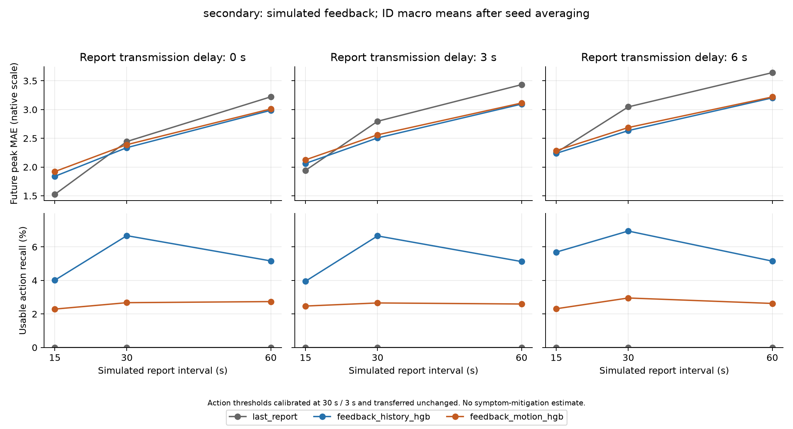

# 数据协议、低频反馈和文献比较：v4 完成报告

日期：2026-10-19。

## 1. 本轮交付

已完成两源编号/评分/缺失审计、固定反馈可用性协议、完整模型评估、逐编号不确定性和针对性文献比较。
共 183 个留编号/种子折、4941 个模型/条件/编号/种子评估组合。
三个模型是最近报告保持、评分历史 HGB 和评分历史加运动 HGB；反馈间隔 15/30/60 秒、延迟 0/3/6 秒，共 9 条件。
HGB 为直方图梯度提升树；回归使用编号等总量基础权重，事件分类在基础权重上再平衡类别，最终分类权重不保证编号等总量。详见 feedback_v4_implementation_notes.md。
协议与拟合代码已在反馈模型拟合前本地冻结；已有 v1–v3 结果可见，本轮属于探索性分析。

## 2. 数据和输入可用性核查

- 第一源审计 69 段，纳入 43 段、13 个作者编号、每条件 1397 个窗口。
- 第二源审计 428 段，属性冲突/无法确认的 38 个编号对应 349 段整组排除，纳入 79 段、48 个作者编号、每条件 4573 个窗口。
- 全部纳入窗口的评分目标、越阈时刻及历史运动特征均从原始记录重算一致；9 条件使用同一窗口队列。
- 第二源 37 段包含局部运动缺失，仅使用历史完整的窗口；不进行未来插值或用未来报告填补。
- 未发现跨编号精确序列重复；PA112/PA114 静态属性重合，但不足以判定同一人，不擅自合并。真实身份及跨编号别名仍需作者确认。
- 每次反馈记录采样、请求和到达时间；预测只读取已经到达的报告，当前真实和未来评分只用于标签/评价。
- 主条件第二源的窗口平均评分年龄为 17.14 秒、最大 30.51 秒；3 秒传输延迟并不等于只有 3 秒陈旧度。
- 保存频率与值变化频率均已统计，但没有实际报告按钮事件，无法恢复真实报告次数、反应时间或填报负担。

第一源 43 段中 38 段含不在 0.1 档位的连续导出值；作者描述与导出记录的对应机制尚未确认，未对评分强制取整。第二源保留原生整数 FMS。

详见 [第一源审计](results/feedback_v4_audit/original/report_zh.md)、[第二源审计](results/feedback_v4_audit/secondary/report_zh.md)。

## 3. 主结果：第二源，30 秒反馈 / 3 秒延迟

| 方法 | 原生峰值 MAE | 可用动作召回 | 误警/分钟 | 动作占用 |
|---|---:|---:|---:|---:|
| 最近已到达评分保持 | 2.7964 | 0.00% | 0.0000 | 0.00% |
| 评分历史 HGB | 2.5062 | 6.66% | 0.3724 | 14.76% |
| 评分历史＋运动 HGB | 2.5610 | 2.66% | 0.2640 | 11.93% |

原生尺度为 0–20 FMS；各编号先平均 3 个随机种子，再按编号宏平均。

运动增强减评分历史的 MAE 差值为 **0.0548**，描述性 95% 区间 **[0.0080, 0.1047]**（48 个配对编号）。
可用动作召回差值为 **-4.00 个百分点**，区间 **[-7.96, -0.85] 个百分点**。

评分历史相对最近报告保持的 MAE 差值为 -0.2902，区间 [-0.6353, 0.0553]；运动增强相对保持为 -0.2354，区间 [-0.5826, 0.1242]。两者区间均跨零，表中的平均误差降低尚不能说明稳定超过保持基线。

运动增强相对评分历史的误差差值区间高于零，主条件下表现更差。可用动作召回差值区间低于零，主条件下也更低；误警和占用下降伴随可用命中损失，不能解释为同等效果下减少干预。运动增强相对最近报告保持的 MAE 尚未获得差值区间低于零的改善证据。

误警、占用约束只在校准编号的主条件上选择阈值；测试编号及其他反馈条件可能超限，不能把校准预算当作逐人保证。

| 数据源 | 方法 | 主条件误警超限折 | 主条件占用超限折 |
|---|---|---:|---:|
| 第一源 | 评分历史 HGB | 4/39 | 4/39 |
| 第一源 | 评分历史＋运动 HGB | 2/39 | 1/39 |
| 第二源 | 评分历史 HGB | 29/144 | 34/144 |
| 第二源 | 评分历史＋运动 HGB | 19/144 | 29/144 |

表中是编号/种子折，不是新增参与者数量。提前量只在命中子集定义，未命中为 NA，详细指标见逐编号结果。

其他 8 条件是固定阈值转用的敏感性分析，不据其最佳单点另立主结论。全部结果与配对区间见结果目录。

## 4. 第一源的支持性分析

| 方法 | 原生峰值 MAE | 可用动作召回 | 误警/分钟 | 动作占用 |
|---|---:|---:|---:|---:|
| 最近已到达评分保持 | 0.1053 | 0.00% | 0.0000 | 0.00% |
| 评分历史 HGB | 0.1370 | 0.00% | 0.1706 | 3.55% |
| 评分历史＋运动 HGB | 0.1439 | 0.93% | 0.0865 | 1.80% |

原生尺度为 0–1，不与第二源的 MAE 数值直接比较。这里仅输入头动，不检验 EEG 增益，队列仍受既有 EEG 质量筛选影响。
v4 与 v3 的输入及训练权重不同，不将跨版本误差差异当作同条件方法提升证据。
运动增强减评分历史 MAE：0.0069，区间 [-0.0060, 0.0201]。
可用动作召回差值：0.93 个百分点，区间 [0.00, 2.78]。
运动增强相对评分历史的误差差值区间跨零，未获得稳定增量信息证据。可用动作召回没有获得区间高于零的稳定改善证据，不能据此声称更适合及时干预。运动增强相对最近报告保持的 MAE 尚未获得差值区间低于零的改善证据。

## 5. 文献定位与论文写法

已完成 [文献比较及证据分层](feedback_v4_literature_zh.md)，覆盖评分辅助预测、个体化、少样本预测与自适应干预。
加入评分、个体化或连接预测和干预本身已有相关研究。本轮定位为信息可用性与动作机会的可复现评估，尚不能将 HGB 或该应用组合视为独立算法创新。
已核对原始摘要与官方/作者全文的内容分开标记；未取得的全文不假装精确复现，不用异任务指标声称全面优于现有方法。
可供整合入论文的 [中文方法、结果和证据边界补充稿](feedback_v4_paper_addendum_zh.md) 单独保存，原稿和旧 PDF 保留。

## 6. 尚未解决的事项

1. 作者编号与真实身份映射，尤其 PA112/PA114 的属性重合；目前结论依赖按作者编号分组的假设。
2. 真实报告事件、人的填报反应和提示影响；抽稀原记录不能测量这些因素。
3. 新场景/新记录验证和最接近文献的完整同条件对照；目前只有编号隔离，场景未整体留出。本轮区间为探索描述且未作多重比较校正。
4. 真实头显采集到显示的时延、症状与任务表现；没有新增真人实验或症状减缓证据。

## 7. 复现与完整性

准备：`analysis/30_prepare_feedback_v4.py`；冻结：`31_freeze_feedback_v4.py`；计算：`32_run_feedback_v4.py`；归档：`33_report_feedback_v4.py`；本报告：`34_write_feedback_documents.py`。
具体命令见 research/README.md。当前锁、完整网格、逐编号结果、阈值搜索及来源校验值均在 results/feedback_v4*。
完整逐窗口输入/预测和原始流位于 Git 忽略的 analysis/data 与 analysis/runs；共享报告只保存审计、分组、结果及校验信息。
初次拟合前的 pandas 只读数组故障及修复已记录，首次失败没有拟合模型；前后锁均保留。见 results/feedback_v4_execution_notes.md。
本轮没有新增或运行单元测试、没有重跑 Unity 验收；数据与结果完整性核查属于本轮研究审计。
