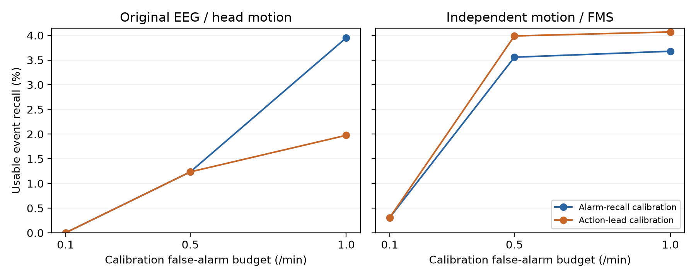

# 三项研究工作：完成情况与实际结论

更新日期：2026-10-15。第二数据源审计与独立评估、Unity 动作时序记录、延迟感知校准对照均已完成。没有新增受试者实验。

## 1. 第二数据源

固定 Ryu/Kim 作者仓库提交 b8285924017f0f128cec98407914ced1073983e8，保存许可、下载与文件 SHA256。无表头 CSV 第一行保留，主分析使用前 420 行。

428 份源 CSV 中，38 个 PA 编号存在性别/年龄/MSSQ 冲突，相关 349 段整组排除。纳入 79 段、48 个属性一致的 PA 编号，产生 4,573 个窗口、1,373 个恶化正窗口和 474 个标签定义的事件组。PA 编号不是本项目招募的人，无法独立确认真实身份或跨编号别名。

输入是过去 9 秒的运动统计，目标是未来 6 秒原生 FMS 增加至少 1 分；当前评分和人口属性不进入被动模型。第一源沿用 13 人有效记录、1,397 窗口和 0–1 评分增加 0.1 的任务。两者分别训练评估，不能直接比较不同刻度的 MAE，也不能将本任务称为源论文的精确复现。

## 2. Unity 与软件验收

已增加报警编号、原始/回放时间映射、报警接收、动作开始、达到倍率 0.80、恢复开始/完成事件，以及逐帧目标/输出倍率。修复重复高风险重置干预开始时间、EOF 截断末次报警和心跳浮点边界问题。有效监测区间精确积分；缺测间隙和恢复收尾分别处理。

四种明确标记为合成的回放与三条真实公开数据留出轨迹均已导出并核对。合成轨迹仅用于软件检查。19 项 Python 检查通过；Unity 原九项合同检查与新增时序、截断、循环重置和移动组件倍率接口检查通过。

原始事件 CSV、逐帧 CSV.gz、输入与来源、积分重算、一致性结果和完整 Unity 日志位于 results/action_validation。实际倍率最大一致性误差约 2.4×10⁻⁷；缺测区间不被计入有效监测时间。

确定性仿真固定 60 Hz、1 倍速，并显式使用无头动桌面回退分支。倍率是控制器输出命令；已验证向移动组件传递，但不能当作测量到的行走速度。Stopwatch 计算计时与模拟时钟分别记录，均不代表头显显示链路时延。

## 3. v3 方法对照

协议和代码在模型比较前冻结，见 action_v3_protocol.md 与 results/action_v3_protocol_lock.json。两个源完成 183 个留一标识/种子折，包含 1,098 个策略/标识/种子组合；拟合、校准和测试按标识隔离。阈值只由校准组选择。

主设置：校准误警预算 0.5 次/分钟，动作占用预算 20%，倍率达到 0.80 后距评分事件至少 2 秒才算可用命中。以下先平均每个标识的种子，再做标识宏平均。无事件标识不进入召回平均。

| 数据源 | 校准目标 | 可用动作召回 | 报警事件召回 | 误警/分钟 | 动作占用 |
|---|---|---:|---:|---:|---:|
| 原公开 EEG/头动 | 报警召回 | 1.23% | 1.23% | 0.0765 | 1.83% |
| 原公开 EEG/头动 | 可用动作召回 | 1.23% | 1.23% | 0.0734 | 1.76% |
| 第二公开运动/FMS | 报警召回 | 3.56% | 9.63% | 0.4020 | 14.82% |
| 第二公开运动/FMS | 可用动作召回 | 3.99% | 10.07% | 0.3616 | 13.67% |

第二源的可用动作召回增加约 0.43 个百分点，按标识配对 bootstrap 的描述性 95% 区间为 [-0.03, 1.22] 个百分点，仍跨零。平均误警减少约 0.0404 次/分钟、占用减少约 1.15 个百分点；这些负担变化不能替代主目标的提升证据。原源主预算下可用动作召回没有增加，1.0 次/分钟预算下反而下降。未支持跨来源、跨预算的一致改进。

图中两个子图是不同数据源与标签定义，只用于各自内部比较。

### 新标识上的预算超限

- 原源，报警召回校准：误警超限 2/39 折，占用超限 1/39 折。
- 原源，延迟感知校准：误警超限 2/39 折，占用超限 1/39 折。
- 第二源，报警召回校准：误警超限 39/144 折，占用超限 31/144 折。
- 第二源，延迟感知校准：误警超限 33/144 折，占用超限 26/144 折。

校准约束为经验宏平均约束，不保证每个新用户满足预算。原源有极短记录，逐人误警率不稳定；种子折并不是新增参与者。

### 回归对照

| 数据源与原生刻度 | 时间 HGB MAE | 传感器 Ridge MAE | 传感器 HGB MAE | 需在线评分的持平参考 MAE |
|---|---:|---:|---:|---:|
| 原源，0–1 | 0.1755 | 0.2133 | 0.1997 | 0.0758 |
| 第二源，0–20 | 4.7357 | 4.9900 | 4.9210 | 0.7460 |

两个源中，传感器 HGB 的观察到的平均误差均没有改善仅时间对照。持平参考需要实时自报，输入条件不同；它不属于被动传感器方法的公平替代。

## 判断与边界

三项实施工作已形成可复现产物；当前结果仍未证明稳定可用的提前预警或实际症状减缓。原有论文保持预研究定位，未把本轮结果改写成已完成的受试者减缓实验。

评分保存频率不等于真实报告频率，评分事件不是生理发作。公开症状是在原暴露条件下采集的，不能随本轮模拟动作改变后继续作为新策略的效果标签。真实减缓效果需要设备、参与者与相应审批支持。

复现入口见 README.md；逐折划分、选阈记录、逐人结果、配对区间和完整性清单见 results/action_v3_original 与 results/action_v3_secondary。
